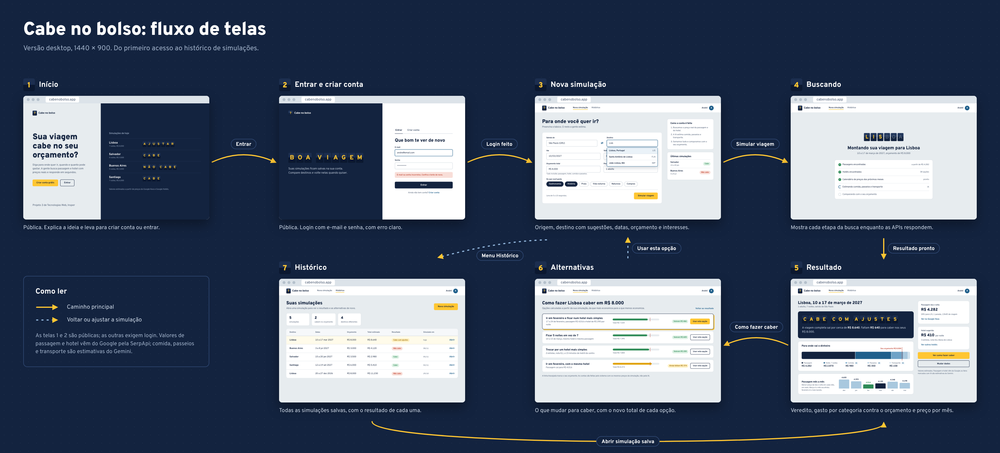

# Cabe no bolso?

Site de planejamento de viagens que responde uma pergunta simples: **a minha viagem cabe no meu orçamento?**

Projeto 3 de Tecnologias Web (Insper, 2026/2).

**Integrantes:** André, Felipe e Henrique.
**Deploy:** a definir (o link entra aqui na Sprint 2).
**Quadro de tarefas:** a definir (colocar aqui o link do GitHub Projects).

## A ideia

A pessoa informa pouca coisa: de onde sai, para onde quer ir, as datas, quanto pode gastar e o que gosta de fazer. O site busca preços reais de passagem e hotel, estima o resto e responde com um veredito:

- **Cabe**: o total estimado fica dentro do orçamento.
- **Cabe com ajustes**: falta pouco, e o site mostra o que mudar (outro mês, menos noites, hotel mais simples).
- **Não cabe**: o site mostra quanto falta e as alternativas mais próximas.

Todos os valores são estimativas, e o site deixa isso claro.

### Como os números são calculados

- Os preços de **voo, calendário de datas e hotel** vêm do Google, pela [SerpApi](https://serpapi.com/).
- A IA (**Gemini**) estima só o que não tem preço pronto: comida, passeios e transporte local, de acordo com os interesses.
- Quem **soma os custos e decide o veredito é o código**, não a IA. Assim a conta é conferível e a IA não inventa o resultado.

## Tecnologias

| Peça | Para que serve |
| --- | --- |
| React + Vite | Telas do site |
| Bootstrap | Estilo e layout |
| Django + Django REST Framework | API, cadastro e login |
| PostgreSQL | Usuários, histórico e cache |
| SerpApi | Voos, calendário de preços e hotéis |
| Gemini (modelo Flash, plano gratuito) | Estimativas de gastos e texto explicativo |
| Render | Deploy |

## Fluxo de telas

Veja o desenho completo em [`docs/fluxo-de-telas.md`](docs/fluxo-de-telas.md).



## Cronograma

### Sprint 1 (10/11 a 13/11): a experiência principal funcionando

- [x] Proposta validada pela professora
- [x] Teste das APIs no Playground da SerpApi
- [ ] Repositório criado, com a professora (BarbaraTieko) como colaboradora
- [ ] Fluxo de telas no repositório
- [ ] Quadro de tarefas no GitHub Projects
- [ ] Projeto Django com DRF e projeto React com Bootstrap
- [ ] Cadastro e login (API e telas)
- [ ] Busca de voos, hotéis e calendário (SerpApi)
- [ ] Estimativa de gastos com o Gemini
- [ ] Regra do veredito (cabe, cabe com ajustes, não cabe)
- [ ] Formulário de simulação e tela de resultado
- [ ] Questionário da equipe respondido

### Sprint 2 (16/11 a 19/11): histórico, alternativas e deploy

- [ ] Histórico de simulações
- [ ] Alternativas automáticas (outro mês, menos noites, hotel mais barato)
- [ ] Cache de 24 horas e limite diário por usuário
- [ ] Acabamento visual
- [ ] Deploy público, com o link neste README
- [ ] Testes automatizados do veredito
- [ ] Teste de precisão com 15 a 20 viagens reais
- [ ] Comparação de duas versões do prompt
- [ ] Feedback de pelo menos 10 pessoas
- [ ] Questionário da equipe respondido

### Apresentação (24/11)

- [ ] Resultados do teste de precisão e do feedback neste README
- [ ] Exemplo concreto de uso de IA durante o desenvolvimento
- [ ] Último commit até as 09:30

A lista detalhada de tarefas, com responsável, tamanho e datas, está no quadro do GitHub Projects. A mesma lista em texto está em [`docs/quadro-de-tarefas.md`](docs/quadro-de-tarefas.md).

## Diferencial: provar que o veredito é confiável

1. **Teste de precisão:** de 15 a 20 viagens reais já feitas por conhecidos, comparamos o total que o site estimou com o gasto real e medimos o erro médio.
2. **Comparação de versões:** as mesmas viagens rodam com duas versões do prompt ou do método, e vemos qual erra menos.
3. **Feedback de usuários:** pelo menos 10 pessoas testam o site e respondem um questionário curto.

Os resultados vão aparecer aqui, na seção *Resultados*, até a apresentação.

## Como rodar o projeto

> Seção em construção. Os comandos abaixo mostram a estrutura prevista (`backend/` e `frontend/`) e serão conferidos quando o código entrar.

Pré-requisitos: Python 3.12 ou mais novo, Node.js 22 ou mais novo, e chaves gratuitas da SerpApi e do Gemini.

### Backend

```bash
cd backend
python -m venv venv
venv\Scripts\activate        # Windows (no Linux/Mac: source venv/bin/activate)
pip install -r requirements.txt
cp .env.example .env         # depois preencha as chaves
python manage.py migrate
python manage.py runserver
```

Variáveis do `.env` (nunca vão para o Git): `SECRET_KEY`, `DEBUG`, `DATABASE_URL`, `SERPAPI_KEY`, `GEMINI_API_KEY`.

### Frontend

```bash
cd frontend
npm install
npm run dev
```

O site abre em `http://localhost:5173` e conversa com a API em `http://localhost:8000`.

### Testes

Os testes usam as respostas salvas em [`fixtures/serpapi/`](fixtures/serpapi/), então não gastam a cota da SerpApi.

## Uso de IA no desenvolvimento

*(Cada integrante anota aqui um exemplo concreto de como usou IA: o que pediu, o que veio, o que mudou. Um deles será mostrado na apresentação.)*

## Resultados

*(Entram na Sprint 2: tabela do teste de precisão, comparação das versões e resumo do feedback.)*
