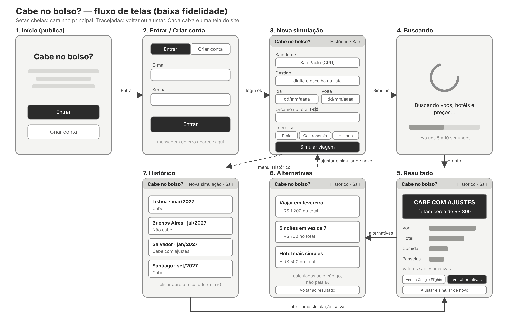
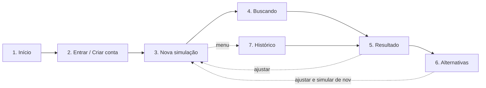

# Fluxo de telas

Desenho de baixa fidelidade das telas do site. Arquivo da imagem: [`fluxo-de-telas.png`](fluxo-de-telas.png) (editável em [`fluxo-de-telas.svg`](fluxo-de-telas.svg)).

## Resumo do caminho

## O que tem em cada tela

| Tela | O que a pessoa faz |
| --- | --- |
| 1. Início | Entende a proposta e escolhe entre entrar e criar conta |
| 2. Entrar / Criar conta | Cadastro e login com e-mail e senha |
| 3. Nova simulação | Escolhe origem e destino (com lista de sugestões), datas, orçamento e interesses |
| 4. Buscando | Espera a busca de voos, hotéis e preços (de 5 a 10 segundos) |
| 5. Resultado | Vê o veredito (cabe, cabe com ajustes ou não cabe), a diferença em reais, o gasto por categoria e o link para o Google Flights |
| 6. Alternativas | Vê o que mudar para a viagem caber: outro mês, menos noites, hotel mais simples |
| 7. Histórico | Reabre simulações antigas |

Todos os valores aparecem como estimativa. Só as telas 1 e 2 são públicas.
