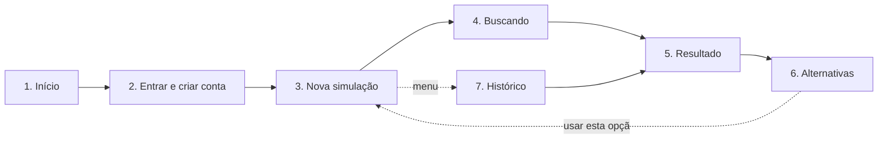

# Fluxo de telas

Versão desktop (1440 × 900) das 7 telas do site e do caminho entre elas.

## Caminho

As setas cheias são o caminho principal. As tracejadas voltam para ajustar a simulação ou abrem o histórico.

## As telas

| Tela | O que a pessoa faz | Imagem |
| --- | --- | --- |
| 1. Início | Entende a ideia e escolhe entre criar conta e entrar. Tela pública. | [ver](telas/01-inicio.png) |
| 2. Entrar e criar conta | Login com e-mail e senha, com mensagem de erro clara. Tela pública. | [ver](telas/02-entrar.png) |
| 3. Nova simulação | Escolhe origem e destino com sugestões, datas, orçamento, pessoas e interesses | [ver](telas/03-nova-simulacao.png) |
| 4. Buscando | Acompanha cada etapa da busca enquanto as APIs respondem | [ver](telas/04-buscando.png) |
| 5. Resultado | Vê o veredito, o gasto por categoria contra o orçamento e o preço da passagem mês a mês | [ver](telas/05-resultado.png) |
| 6. Alternativas | Vê o que mudar para a viagem caber, com o novo total de cada opção | [ver](telas/06-alternativas.png) |
| 7. Histórico | Reabre simulações antigas | [ver](telas/07-historico.png) |

## Identidade visual

- **Ideia central:** os painéis de embarque dos aeroportos. O veredito aparece em plaquinhas, como um voo no painel de partidas.
- **Fonte:** Overpass, inspirada nas placas de estrada (disponível no Google Fonts).
- **Cores:**

| Nome | Cor | Uso |
| --- | --- | --- |
| Tinta | `#13233F` | Textos, painéis e botões principais |
| Sinal | `#FFC632` | Letras das plaquinhas e botão de ação principal |
| Pista | `#1F5F8B` | Links e destaques secundários |
| Céu | `#E7ECEF` | Fundo das páginas |
| Cabe | `#2E8B57` | Resultado "cabe" |
| Não cabe | `#C2412D` | Resultado "não cabe" e linha do orçamento |

Os preços de passagem nas telas vêm de buscas reais na SerpApi (São Paulo para Lisboa). Os demais números são exemplos.
